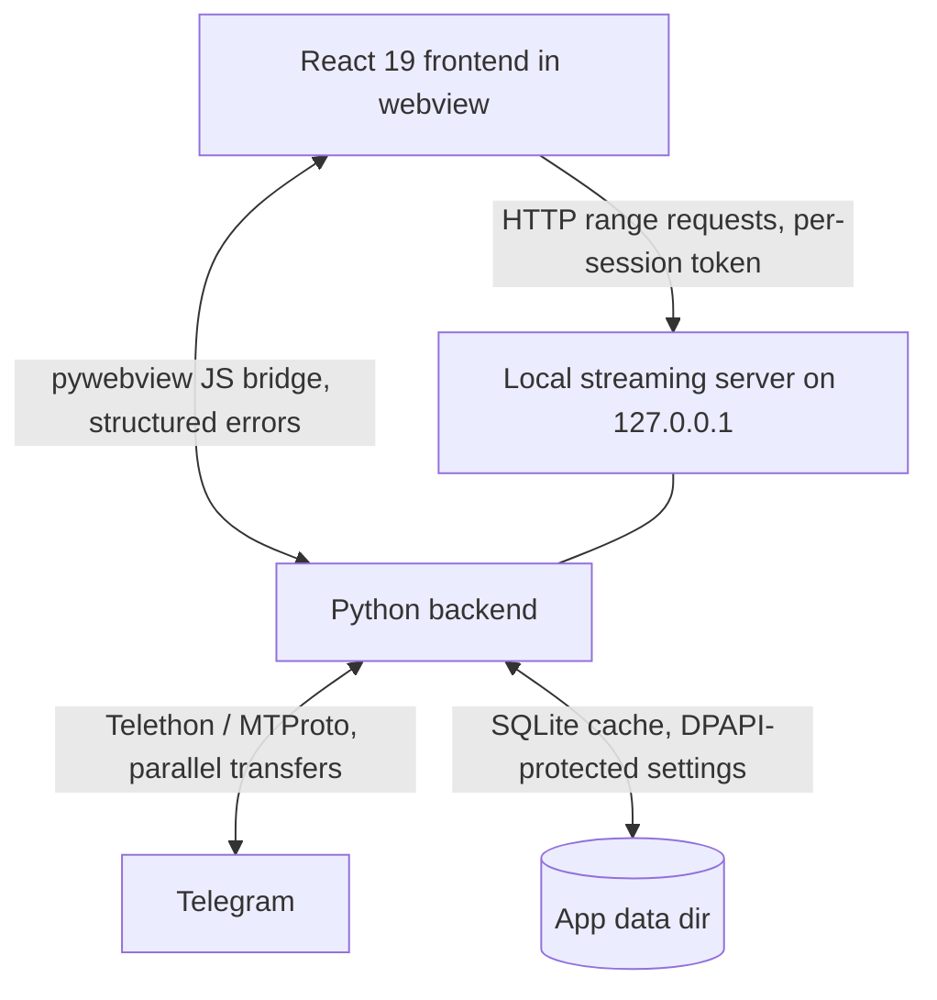

# <div align="center">☁️ Telegrab</div>

<div align="center">
  <h3>Turn Telegram into your high-speed, unlimited, and private cloud storage.</h3>
  <p>No storage caps. No monthly subscriptions. Just your files — on the cloud you already trust.</p>
</div>

<p align="center">
  
  
  
  
</p>

---

## ✨ Features

- **🚀 Max-Speed Transfer Engine**
  Powered by a custom-engineered multi-connection chunking engine, Telegrab splits files into optimal parts and uploads/downloads them in parallel, unlocking your network's maximum potential speed.
- **📁 Fluid Desktop File Explorer**
  Enjoy a sleek, Linear-inspired interface with fluid animations, drag-and-drop mechanics, full folder structures, instant search, and visual list/grid view toggles.
- **🎬 Instant Media Streaming**
  Watch HD/4K videos or listen to audio tracks instantly via high-efficiency local streaming without waiting for the full file download.
- **🔒 Encrypted Vaults**
  Turn any folder into a vault: files are encrypted with AES-256-GCM on your device before upload. Vault settings are stored in the folder itself on Telegram, so vaults keep working after a reinstall or on another computer. There is no password recovery.
- **🌐 Proxy Support**
  Connect through SOCKS5, SOCKS4, HTTP or MTProxy — configurable from the sign-in screen and Settings → Network.
- **🔌 Offline-Resilient Transfer Queue**
  Add files to transfer queues offline. Telegrab handles network changes gracefully, automatically pausing transfers and resuming them once connection is restored.
- **🔄 Auto-Updates & Single Instance Lock**
  Keeps itself updated seamlessly and prevents session database corruption using a multi-process mutex lock.

---

## 🏗️ Architecture & Technology Stack

Telegrab is split into a Python backend managing the MTProto Telegram client and a React frontend running in a native webview.



* **Frontend**: React 19 • TypeScript • Tailwind CSS • Vite • Framer Motion • TanStack Query & Virtualizer
* **Backend**: Python 3.12 • Telethon (MTProto) • pure-asyncio streaming server • cryptography • PyInstaller
* **Desktop Layer**: Python-Webview (utilizing system native engines WebView2 on Windows, WebKit2GTK on Linux, and WebKit on macOS)

---

## 🚀 Quick Start for Users

1. **Download the Client**
   Grab the latest installer or portable executable for your operating system from the **[Releases](https://github.com/jithin-jz/telegrab/releases)** tab.
2. **Retrieve your Telegram API Keys**
   To log in, you will need a personal API ID and Hash.
   * Go to **[my.telegram.org](https://my.telegram.org)**.
   * Log in with your phone number and navigate to **API development tools**.
   * Copy the `api_id` and `api_hash`.
3. **Connect and Run**
   Launch Telegrab, paste your API credentials, and log in securely via Phone Number + OTP code or Telegram's QR Code sign-in.

---

## 💻 Developer Setup & Installation

If you want to run Telegrab locally or contribute to development, follow the setup instructions below.

### Prerequisites
* **Python 3.11+** (CI and releases use 3.12)
* **[uv](https://docs.astral.sh/uv/)** for the Python environment
* **Node.js 20.11+ & npm**

### 1. Clone the Repository
```bash
git clone https://github.com/jithin-jz/telegrab.git
cd telegrab
```

### 2. Set up the Python backend
Create `backend/.venv` from the lockfile (runtime + dev tools):
```bash
cd backend
uv sync
```

### 3. Set up the frontend
```bash
cd frontend
npm ci
```

### 4. Run the application
From the repository root:
```bash
python run.py --dev   # Vite dev server with hot reload
python run.py         # production bundle (built if missing)
```

Logs go to `telegrab.log` in the app data directory (`%APPDATA%\telegrab`,
`~/Library/Application Support/telegrab`, or `~/.local/share/telegrab`).

---

## 🧪 Checks
The same checks run in CI on every push and pull request:
```bash
# backend
cd backend
uv run ruff check telegrab/ tests/
uv run ruff format --check telegrab/
uv run pytest tests/

# frontend
cd frontend
npm run lint && npm run typecheck && npm test && npm run build
```

---

## 📦 Releasing
1. `python scripts/bump_version.py X.Y.Z` (updates every version string and `uv.lock`), then commit.
2. Push a `vX.Y.Z` tag. The release workflow builds Windows, macOS and Linux packages, smoke-tests each binary with `--self-test`, and publishes them with a `SHA256SUMS` file.

Optional repository secrets enable code signing (Windows Authenticode, macOS signing + notarization) and update signing — see the header of `.github/workflows/release.yml`. To require signed updates, generate a key pair with `python scripts/update_signing.py keygen`, store the private key as the `UPDATE_SIGNING_KEY` secret, and set `UPDATE_PUBLIC_KEY` in `backend/telegrab/services/updater.py`. Without code signing, Windows SmartScreen and macOS Gatekeeper will warn users.

---

## 🤝 Credits & Inspiration

* **[Telegram-Drive](https://github.com/caamer20/Telegram-Drive)** by [@caamer20](https://github.com/caamer20) — Served as the core design inspiration. Telegrab is a complete performance-focused rewrite in Python with native webview bindings.

---

## 📄 License & Disclaimer

This project is licensed under the MIT License. See [LICENSE](LICENSE) for details.

> ⚠️ **Disclaimer**: This application is an unofficial client and is not affiliated with, sponsored by, or endorsed by Telegram FZ-LLC. Use responsibly and in accordance with Telegram's Terms of Service.
